# PES 6 Legacy Remaster — Ultimate Expansion Master Architecture
## Comprehensive Technical Specification, Reverse-Engineering Foundations & Implementation Roadmap

**Document ID:** `REMASTER_EXPANSION_MASTER_ARCHITECTURE`  
**Status:** `ARCHITECTURAL BLUEPRINT — READY FOR REVIEW`  
**Target Architecture:** Windows 32-bit x86 PE (`pes6.exe`, Retail 1.0 European)  
**Host Hooking:** MinHook Detours (`remaster.asi`) + Kitserver 6.8.0 Module Suite (`kload.dll`, `afs2fs.dll`, `lodmixer.dll`, `stadium.dll`, `bserv.dll`, `bootserv.dll`, `gloves.dll`, `skins.dll`)  

---

### Executive Vision

This architecture defines the complete transformation of PES 6 from a retro classic into a **definitive, broadcast-grade Enhanced Edition**. By unifying our native `remaster.asi` Direct3D detours with the proven extensibility of Kitserver 6 and the non-destructive AFS2FS asset streaming system, the remaster achieves modern visual fidelity, authentic 2006 atmospheric audio, and deep tactical immersion while preserving 100% of the core Konami physics engine.

---

### Part 1: Reverse-Engineering Discoveries & Subsystem Foundations

#### 1.1 LOD Mixer & Model Precision Engine (`lodmixer.dll` & `lodmixer.dat`)
Through binary reverse engineering of `lodcfg.exe` and `lodmixer.dll` (retail version 6.8.2), the exact 41-byte binary configuration structure of `lodmixer.dat` has been decoded:

```
[ lodmixer.dat — 41-Byte Binary Structure ]
Offset 0x00..0x1F (32 bytes) : Internal matrix constants & aspect ratio buffers
Offset 0x20      (1 byte)   : Aspect ratio correction mode (0x01 = Widescreen active)
Offset 0x21..0x25 (5 bytes)   : LOD Level Selectors for Cameras 1..5 (0-indexed: 0x00 = LOD 1)
Offset 0x26      (1 byte)   : Controller check flag
Offset 0x27      (1 byte)   : Crowd unblock switch (0x01 = "Show crowd on all cameras")
Offset 0x28      (1 byte)   : Crowd stance flag
```

* **The Problem in Vanilla PES 6:** The Konami engine aggressively switches players to low-poly LOD 3/4 and downsampled kit textures ($256 \times 128$ and $128 \times 64$) on standard gameplay cameras (Normal Long, Wide). This causes player balding, missing captain armbands, and blurry shirt numbers during live play.
* **The Remaster Solution:** By programming `lodmixer.dat` with `00-00-00-00-00` across bytes `0x21..0x25`, the engine is forced into **Permanent LOD 1 (Maximum Polycount & 512x256 Texture Streaming)** across every camera distance, cutscene, and replay. Setting byte `0x27 = 0x01` unblocks animated 3D crowds across all broadcast angles.

---

#### 1.2 Non-Destructive Asset Ingestion Engine (`afs2fs.dll`)
Rather than risking archive corruption by rebuilding multi-hundred-megabyte AFS files (`0_text.afs`, `0_sound.afs`, `e_text.afs`, `e_sound.afs`), the remaster leverages Kitserver's `afs2fs.dll` virtual filesystem:

```
[ kitserver\dat\ ]
       |
       +---> [ 0_text.afs\ ]   --> unnamed_535.bin, unnamed_536.bin (HUD & UI)
       +---> [ 0_sound.afs\ ]  --> unnamed_<id>.adx (Authentic Club Chants & FX)
       +---> [ e_text.afs\ ]   --> unnamed_<id>.bin (HD Menus, Vectors & Crests)
       +---> [ e_sound.afs\ ]  --> unnamed_<id>.adx (Iconic 2006 Soundtrack)
```

* **Naming Syntax:** Any file formatted as `<name>_<BIN_ID>.bin` (or `.adx`) placed within the corresponding `.afs` folder intercepts that exact resource dynamically at runtime.
* **Integrity Guarantee:** The base archives (`dat\0_text.afs`, `dat\0_sound.afs`) remain strictly read-only and bit-exact, allowing instantaneous rollback at any time.

---

#### 1.3 StadiumServer Architecture (`stadium.dll`)
StadiumServer operates via `GDB\stadiums\`, where each venue contains a standardized 69-file structure:

```
[ GDB\stadiums\<Stadium_Name>\ ]
       |
       +-- info.txt         --> built = <year>, capacity = <int>, city = <string>
       +-- preview.png      --> 128x64 venue selection thumbnail
       +-- adboards_tex\    --> Dedicated venue perimeter advertising BIN
       +-- 1_day_fine\      --> pitch.bin, crowd_*.str, stand_*.bin, roof.bin, lights.bin
       +-- 2_day_rain\      --> Wet surface pitch.bin, rain overlays, overcast lighting
       +-- 3_day_snow\      --> Snow turf pitch.bin, winter crowd apparel
       +-- 4_night_fine\    --> Floodlight lighting matrix, night skybox, illuminated pitch
       +-- 5_night_rain\    --> Reflective night pitch, wet spectator stands
       +-- 6_night_snow\    --> Winter evening conditions
```

Mapping occurs cleanly in `GDB\stadiums\map.txt` by linking team IDs to venue folder names.

---

#### 1.4 BallServer & BootServer Curation (`bserv.dll`, `bootserv.dll`, `gloves.dll`)
* **BallServer (`bserv.dll`):** Configured via `GDB\balls\map.txt` using the syntax:
  `"<Display Name>", "<model_file.bin>", "<texture_file.png>"`
  Supports native auto-detection of $256 \times 256$, $512 \times 512$, and $1024 \times 1024$ PNG/BMP textures with 3D rotational preview on the kit selection screen.
* **BootServer (`bootserv.dll`):** Configured via `GDB\boots\map.txt` using:
  `<Player_ID>, "<subfolder\boot_texture.png>"`
  Overcomes the hardcoded 9-slot boot limitation, allowing hundreds of individual players to wear their authentic 2006 boots.
* **GloveServer (`gloves.dll`):** Assigns authentic branded goalkeeper gloves (Reusch, Adidas Fingersave, Uhlsport, Nike Vapor) per player ID.

---

### Part 2: System-by-System Architecture & Scope of Enhancements

```mermaid
flowchart TD
    subgraph CoreEngine ["PES 6 Host Core (pes6.exe)"]
        D3D8Host["Direct3D 8 Host Pipeline"]
        SoundHost["DirectSound Audio Mixer"]
        GameLogic["Tactics & AI Engine (0x00A52140)"]
    end

    subgraph GraphicsLayer ["Visual Fidelity Subsystems"]
        LODMixer["LOD Mixer: Force 1,1,1,1,1 & Crowd Unblock"]
        InternalRes["Kingsley813 1080p/1440p Scaling"]
        HiresStream["remaster_pack Texture Supersampling"]
        StadiumGDB["StadiumServer 3D Arenas (Highbury, San Siro, Camp Nou)"]
        BallGDB["BallServer (T90 Aerow II, Teamgeist, Finale)"]
        BootGDB["BootServer (Predator Absolute, Vapor III, T90 Supremacy)"]
        ShaderPost["D3D8/D3D9 Filmic Color Grading & Wet Specular"]
    end

    subgraph AudioLayer ["Atmosphere & Soundscape Subsystems"]
        AFS2FSSound["AFS2FS 0_sound.afs Virtual Hook"]
        ClubChants["Team-Specific Real Crowd Anthems (YNWA, Arsenal, Madrid)"]
        MatchSFX["Crisp Ball Impacts, Post Clang & Net Ripple"]
        MenuOST["2006 Golden Era Soundtrack (Kasabian, Bloc Party)"]
    end

    subgraph PresentationLayer ["Broadcast & Database Subsystems"]
        ModernHUD["Glass Score Bug & Stoppage-Time Engine"]
        LiveAnalytics["Real-Time xG, Momentum & Field Tilt"]
        ScoreboardThemes["Broadcast Themes (Sky Sports 2006, UCL Starball)"]
        HDCrests["Vector Club Crests & Competition Emblems"]
        Rosters2006["Authentic 2006/07 Database & Classic Leagues"]
    end

    D3D8Host --> LODMixer
    D3D8Host --> InternalRes
    D3D8Host --> HiresStream
    D3D8Host --> StadiumGDB
    D3D8Host --> BallGDB
    D3D8Host --> BootGDB
    D3D8Host --> ShaderPost

    SoundHost --> AFS2FSSound
    AFS2FSSound --> ClubChants
    AFS2FSSound --> MatchSFX
    AFS2FSSound --> MenuOST

    GameLogic --> ModernHUD
    GameLogic --> LiveAnalytics
    GameLogic --> ScoreboardThemes
    GameLogic --> HDCrests
    GameLogic --> Rosters2006
```



---

### Part 3: Detailed Technical Specifications by Subsystem

#### Subsystem 1: Visual Precision & Match Environments
1. **LOD 1 Forcing:**
   - Modify `lodmixer.dat` to set all 5 LOD thresholds to `00-00-00-00-00`.
   - Set crowd unblock flag to `01`.
   - Ensure `lodmixer.dll` is active in `kload.cfg`.
2. **Iconic 2006 Stadium Pack:**
   - Curate and configure top European cathedrals of football:
     - Highbury (Arsenal 2006 Farewell Season)
     - Stamford Bridge (Chelsea)
     - Camp Nou (Barcelona)
     - Santiago Bernabéu (Real Madrid)
     - San Siro / Giuseppe Meazza (Milan & Inter)
     - Anfield (Liverpool)
     - Old Trafford (Manchester United)
   - Calibrate custom perimeter adboards (`adboards_tex\`) and multi-frequency turf per stadium.
3. **Official Match Ball Pack:**
   - 2006 UEFA Champions League: *Adidas Finale Paris 2006 Capitano*.
   - 2006 FIFA World Cup Germany: *Adidas Teamgeist Match Ball*.
   - 2006/07 Premier League & La Liga: *Nike Total 90 Aerow II (Classic White/Blue & Hi-Vis Yellow)*.
   - 2006 Serie A & Ligue 1: *Nike Total 90 Aerow I*.
4. **Authentic Period Boot Pack:**
   - Map key star players:
     - Zidane, Gerrard, Lampard, Beckham: *Adidas Predator Absolute*.
     - Henry, Cristiano Ronaldo, Ibrahimovic: *Nike Mercurial Vapor III*.
     - Rooney, Figo, Roberto Carlos, Puyol: *Nike Total 90 Supremacy*.
     - Ronaldinho, Pirlo: *Nike Tiempo Legend*.
     - Eto'o, Pires: *Puma v1.06*.
     - Shevchenko: *Lotto Zhero Gravity*.

---

#### Subsystem 2: Audio Atmosphere & Soundscapes
1. **Club-Specific Chants & Anthems:**
   - Ingest audio tracks via `kitserver\dat\0_sound.afs\`.
   - Encode authentic multi-track crowd chants in 32 kHz ADX streaming format:
     - Liverpool: *"You'll Never Walk Alone"*, *"Fields of Anfield Road"*.
     - Arsenal: *"Good Old Arsenal"*, *"Arsenal! Arsenal!"*.
     - Manchester United: *"Glory Glory Man United"*, *"United Calypso"*.
     - Chelsea: *"Carefree"*, *"Blue Is The Colour"*.
     - Real Madrid: *"Hala Madrid y Nada Más"*.
     - Barcelona: *"El Cant del Barça"*.
     - Milan / Inter: Authentic San Siro ultras drum rolls and chorus.
2. **Match SFX Upgrade:**
   - Replace generic ball kicks with rich low-frequency acoustic strikes.
   - Replace goal net sounds with genuine cord rustle upon goal impact.
3. **Licensed 2006 Golden Era Menu Soundtrack:**
   - Ingest iconic tracks into `kitserver\dat\e_sound.afs\`:
     - Kasabian — *Club Foot*
     - Bloc Party — *Helicopter*
     - Franz Ferdinand — *Take Me Out*
     - Caesars — *Jerk It Out*
     - Massive Attack — *Teardrop*

---

#### Subsystem 3: User Interface, Vectors & Presentation
1. **HD Emblems & Competition Logos:**
   - Leverage `custom_logo_loader.cpp` and `e_text.afs` overrides.
   - High-contrast, clean 32-bit vector badges for Premier League, UEFA Champions League, La Liga, Serie A, and National Teams.
2. **Broadcast Scoreboard Packages:**
   - Expand `modern_hud.cpp` with user-selectable broadcast packages via `remaster.ini`:
     - Theme 1: Modern Minimal Glass (Default).
     - Theme 2: Sky Sports 2006 Retro Broadcast.
     - Theme 3: UEFA Champions League Starball Package.
3. **Tactical Formation HUD:**
   - Enhanced pitch radar with high-contrast player pips and dynamic tactical shape outlines.

---

#### Subsystem 4: Rosters & Historical Database
1. **Option File Verification (`KONAMI-WIN32PES6OPT`):**
   - Verify starting lineups, squad numbers, classic formations (Arsenal 4-4-2, Chelsea 4-3-3, Milan 4-3-1-2 Christmas Tree, Barca 4-3-3).
   - Ensure accurate player physical attributes, positions, and registered boots.
2. **Custom Tournament Extensibility:**
   - Configure `club_hooks_leagues.cpp` to expose historical cups:
     - 2006 UEFA Champions League Tournament mode.
     - 2006 FIFA World Cup Germany mode.

---

#### Subsystem 5: Direct3D Shader Enhancements
1. **Wet Pitch Specular Shader:**
   - Inject subtle surface gloss reflection during rainy evening matches via the Boris Vorontsov D3D8->D3D9 wrapper.
2. **ACES Tonemapping & Floodlight Grading:**
   - Preset-driven color curves in `remaster.ini` providing natural grass warmth under daytime conditions and rich contrast under stadium floodlights.

---

### Part 4: Technical Guardrails & Constraints

1. **32-Bit Memory Ceiling Constraint:**
   - Total process allocations (textures, backbuffers, sound buffers, GDB cache) must never exceed $1,200\text{ MB}$.
   - At least $800\text{ MB}$ of virtual address space headroom must remain free below the 2,048 MB limit to guarantee zero crash risk.
2. **Zero Permanent File Mutations:**
   - Original `pes6.exe` (SHA256: `649dc2fc...`) and `dat\0_text.afs` (SHA256: `f611a065...`) must remain strictly untouched on disk.
   - All assets stream via `remaster_pack\`, `GDB\`, or `kitserver\dat\`.
3. **Fail-Closed Rollback Guarantee:**
   - Setting `[core] enabled = 0` in `remaster.ini` or unhooking Kitserver must return the game to 100% pure vanilla 2006 execution within 3 seconds.
4. **Strict No-Uncanny-Valley Facial Policy:**
   - Preserve original Konami facial geometry streaming from `0_text.afs`. Procedural and AI face textures remain suspended.

---

### Part 5: Phased Implementation Roadmap

```
PHASE 1: VISUAL & MODEL PRECISION (LOD MIXER & GDB INFRASTRUCTURE)
  - Program lodmixer.dat: Force LOD 1 (1,1,1,1,1) & enable crowd unblock.
  - Setup GDB directories: GDB\balls, GDB\boots, GDB\gloves, GDB\stadiums.
  - Deploy authentic 2006 Ball Pack (T90 Aerow II, Teamgeist, Finale) & verify in bserv.
  - Deploy authentic 2006 Boot Pack (Predator, Vapor III, T90) & map star players in bootserv.
  - Deploy authentic Goalkeeper Gloves in gloveserv.
  - Verify 60 FPS locked, zero LOD model downsampling, and zero memory leaks.

PHASE 2: STADIUMS & VENUE INTEGRATION (STADIUM SERVER)
  - Ingest iconic stadiums (Highbury, Stamford Bridge, Camp Nou, Bernabeu, San Siro, Anfield).
  - Verify 6 weather scenarios per venue (1_day_fine through 6_night_snow).
  - Configure GDB\stadiums\map.txt linking team IDs to home grounds.
  - Verify stadium lighting, crowd placement, and adboard rendering.

PHASE 3: AUDIO ATMOSPHERE & SOUNDSCAPES (AFS2FS)
  - Configure kitserver\dat\0_sound.afs\ and kitserver\dat\e_sound.afs\.
  - Encode and deploy team-specific authentic crowd chants (Liverpool, Arsenal, Man Utd, Chelsea, Madrid, Barca, Milan).
  - Deploy enhanced match sound effects (ball strike thud, post clang, net rustle).
  - Deploy licensed 2006 golden era menu soundtrack (Kasabian, Bloc Party, Franz Ferdinand).

PHASE 4: USER INTERFACE, CRESTS & BROADCAST PACKAGES
  - Deploy vector-crisp club crests and tournament logos.
  - Expand modern_hud.cpp with selectable broadcast packages (Sky Sports 2006, UCL Starball, Glass).
  - Polish tactical radar and formation board graphics.

PHASE 5: DATABASE, ROSTERS & TOURNAMENT POLISH
  - Verify Option File KONAMI-WIN32PES6OPT lineups, squad numbers, and tactics.
  - Expose historical tournament structures via club_hooks_leagues.cpp.

PHASE 6: SHADERS, PERFORMANCE CERTIFICATION & FINAL HANDOFF
  - Calibrate rainy pitch specular maps and ACES color grading presets.
  - Profile 1080p, 1440p, and 4K performance across full 90-minute tournament matches.
  - Update tools\remaster_configurator.py and automated test suite (test_core.exe).
  - Deliver final engineering certification and Codex/Opus handoff manual.
```
